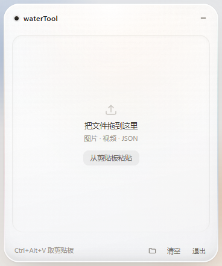
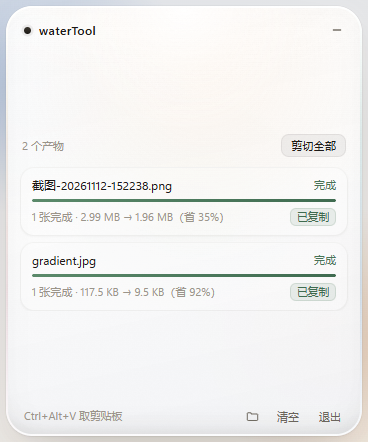

# LiquidTools

> Windows 上的「灵动岛」式小工具集合：把文件拖到屏幕顶部的小胶囊上，它自动识别类型、给出参数、跑完把结果塞进剪贴板。

<p align="center">
  
</p>

平时它只是屏幕顶部一条几乎不可见的胶囊，不占任务栏、不抢焦点、不弹窗。有输入（拖放、截图、复制的文件）才展开，处理完自动收回。

## 预览

| 展开面板 | 处理结果 |
|:---:|:---:|
|  |  |

## 功能

### 图片压缩

基于 `sharp`（libvips），支持 `png / jpg / webp / avif / bmp / gif / tiff`。

- **输出格式可选**：保持原格式，或转 WebP / JPG / PNG
- **质量可调**：1–100，拖动即生效
- **压缩后大小实时预估**：不是公式估算，而是按当前参数**真的编码一遍**再读字节数（不写盘），实测与最终产物误差 0–3%
- 转 JPG 时自动铺白底，避免透明区域变黑
- 同格式且压不动时不会生成无用文件，直接提示「已是最优」

### 视频处理

基于 `ffmpeg`，支持 `mp4 / mov / mkv / avi / webm / flv / wmv / m4v / ts / mts`。

- **仅优化播放**：`-c copy -movflags +faststart`，不重新编码、画质无损、几秒完成。把 `moov` 原子从文件尾部挪到头部，解决「网络视频必须下完才能播」
- **转码压缩**：可选质量与分辨率

### JSON 工具

独立窗口，支持 JSON / YAML / CSV / XML 互转。CSV 对 `{ title, items: [...] }` 这类嵌套结构会智能展平，而不是丢一堆 `[object Object]`。

## 三种输入方式

| 方式 | 说明 |
|---|---|
| 拖放 | 把文件拖到胶囊上，鼠标经过时自动展开 |
| 剪贴板 | 截图、在资源管理器复制的文件、复制的 JSON 文本。检测到内容时胶囊会提示，点一下或按热键取用 |
| 热键 | 不用对准鼠标，直接全局快捷键 |

| 热键 | 作用 |
|---|---|
| `Ctrl + Alt + Space` | 显示 / 隐藏岛 |
| `Ctrl + Alt + J` | 打开 JSON 工具窗口 |
| `Ctrl + Alt + V` | 取剪贴板内容 |

## 产物落在哪

| 来源 | 保存位置 |
|---|---|
| 拖进来的文件 | 与源文件**同一目录**，加后缀 `_min`（视频「仅优化播放」加 `_web`），重名自动追加 `-1` |
| 剪贴板截图 | 产物目录，默认 `图片\waterTool` |

产物目录可在岛底部右下角的文件夹图标上**右键**更换（左键是打开当前目录），设置记录在 `%APPDATA%\waterTool\settings.json`。

处理完成后：

- **单个产物**会自动进剪贴板（图片是真位图，视频是文件），随处 `Ctrl+V` 即可
- 多个产物时，结果列表上方会出现 `N 个产物 · 剪切全部`，点一下以 Windows「剪切」格式进剪贴板，到目标文件夹粘贴即完成搬家

## 运行

要求 Windows 10/11、Node 18+。

```bash
npm install
```

然后双击 `启动.bat`，或：

```bash
npm start
```

> `启动.bat` 里有一行 `set ELECTRON_RUN_AS_NODE=`，别删。从某些 Electron 系终端（如部分 IDE 内置终端）启动时会继承这个环境变量，它会让 `electron.exe` 退化成纯 Node 运行时，表现是启动即崩溃、什么都不显示。

依赖体积参考：`electron` 约 300 MB，`sharp` + `ffmpeg` 约 60 MB。

## 项目结构

```
src/
├─ main/
│  ├─ main.js              窗口、点击穿透、托盘、热键、剪贴板监听、任务分发、诊断截图
│  ├─ jobs.js              串行任务队列，支持取消与进度上报
│  ├─ settings.js          产物目录等设置（%APPDATA%\waterTool\settings.json）
│  ├─ image-engine.js      统一出口的 sharp 实例（关掉文件缓存，见下）
│  └─ tools/
│     ├─ registry.js       工具注册表 + 按 payload 匹配
│     ├─ image-compress.js 图片压缩（含「只算不写」的大小预估）
│     ├─ video.js          视频 faststart / 转码
│     └─ json-format.js    JSON 工具
├─ preload.js              contextBridge 暴露的 API（渲染层不碰 Node）
└─ renderer/
   ├─ app.js / index.html / styles.css   岛本体：状态机、参数面板、任务卡、液态玻璃
   └─ json/                              JSON 编辑器独立窗口
```

新增工具只需要写一个 `{ id, name, hint, icon, match(payload), options, run(payload, ctx) }` 并注册，UI 会按 `options` 自动生成控件。

## 几个实现上的取舍

**点击穿透**用 `setIgnoreMouseEvents(true, { forward: true })` 动态切换。光标进入由 Windows 转发的 `WM_MOUSEMOVE` 驱动（事件，零延迟）；但**离开**和**文件拖放**只能轮询光标位置——穿透窗口移出后收不到任何消息，OLE 拖拽期间鼠标被拖拽源 `SetCapture` 抓走，Windows 也没有「有东西拖进来了」的通知。轮询按距离自适应（贴边 55ms / 远处 240ms），单次 `getCursorScreenPoint()` 约 0.45µs。

**玻璃不透明度写死**在 0.94–0.985，不做「按桌面亮度自适应」。曾经做过：每 12 秒截一次全屏算平均亮度，单次 200ms 的同步 CPU 会占死主进程事件循环，表现为鼠标卡住半秒然后瞬移。而玻璃本来就接近实心，自适应收益肉眼不可见。

**`sharp.cache({ files: 0 })`**（见 `image-engine.js`）。libvips 默认会缓存打开过的文件，在 Windows 上按内存映射持有句柄——用路径解码 WebP 产物后，那个文件会被锁到进程退出，用户删图时报「被 electron 占用」。关掉文件缓存即可，内存缓存与操作缓存保留。

**任务串行**执行（`jobs.js`），避免同时压十张图把 CPU 打满。

## 已知限制

- 只做了 Windows；macOS / Linux 上的透明窗口、置顶、穿透行为都没验证
- 不做真·背景模糊（acrylic + `setShape` 会连绘制一起裁剪，阴影和边缘高光会被切掉，且动画每帧都要改区域）
- 没有安装包、自动更新、开机自启、多语言——这是自用工具，不是产品
- 托盘图标是运行时画出来的 SVG，不是资源文件

## License

MIT
